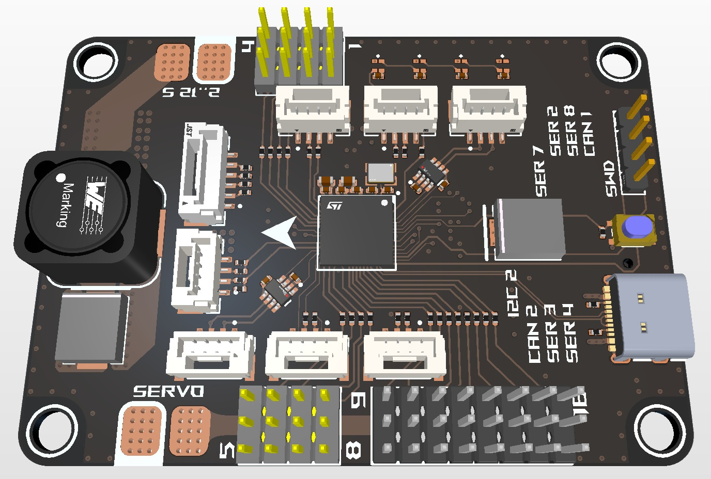

# CRLS H743 Flight Controller



STM32H743 flight controller with firmware targets for [ArduPilot](https://ardupilot.org/) and [Betaflight](https://betaflight.com/).

## Features

- **MCU:** STM32H743 (BGA)
- **IMUs:** Triple redundant, each on its own SPI bus
- **PWM outputs:** 16 channels
- **UARTs:** 5
- **CAN:** 2 buses
- **Storage:** microSD card

With this set of I/O, the board is versatile enough for almost any UAV setup.

## Repository layout

| Path | Contents |
| --- | --- |
| [hardware/h743/](hardware/h743/) | Altium Designer project (schematics, PCB, stackup, BOM, output job) |
| [firmware/ardupilot/](firmware/ardupilot/libraries/AP_HAL_ChibiOS/hwdef/CRLSH743/) | ArduPilot hardware definition (`hwdef.dat`, bootloader `hwdef-bl.dat`, `defaults.parm`) |
| [firmware/betaflight/](firmware/betaflight/src/config/configs/CRLSH743/) | Betaflight board config (`config.h`) |
| [docs/schematic.pdf](docs/schematic.pdf) | Schematic |
| [docs/datasheets/](docs/datasheets/) | Reference datasheets |
| [images/](images/) | Board renders and photos |

## ArduPilot

Copy `firmware/ardupilot/libraries/AP_HAL_ChibiOS/hwdef/CRLSH743` into the same path in an ArduPilot checkout, then build:

```sh
./waf configure --board CRLSH743
./waf copter
```

To build the bootloader:

```sh
./Tools/scripts/build_bootloaders.py CRLSH743
```

`AP_HW_CRLSH743` is not in ArduPilot's `Tools/AP_Bootloader/board_types.txt` yet, so add a board ID there before building.

## Betaflight

Copy `firmware/betaflight/src/config/configs/CRLSH743` into the same path in a Betaflight checkout, then build:

```sh
make CONFIG=CRLSH743
```

Differences from the ArduPilot target:

- Outputs 1-8 are motors and 9-12 are servos. Outputs 13-16 (TIM1) are left free as the DShot bitbang timer.
- The ICP-20100 barometer is not supported by Betaflight.
- CAN is not used.
